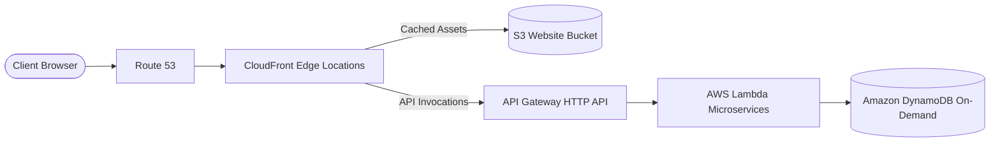

# Architecture 2: Serverless Jamstack Static Platform

## Highlights
- Sub-50ms global latency via CloudFront edge caching.
- Zero server maintenance, automated scaling, and pay-per-request pricing.
